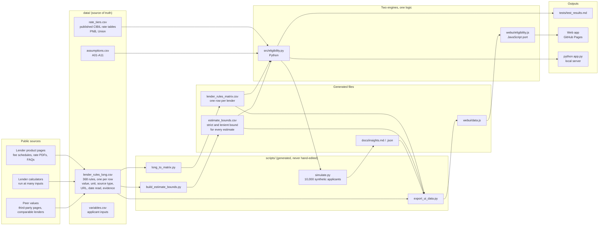
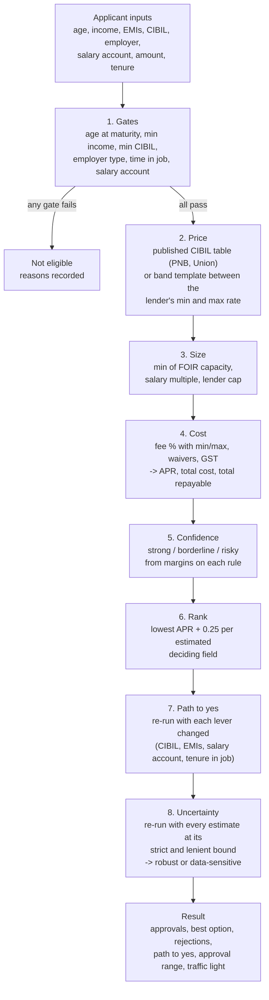
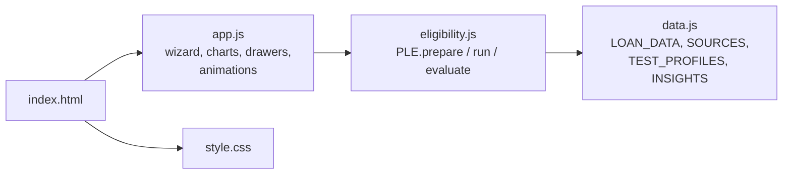
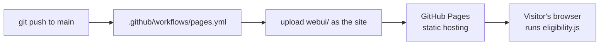

# System architecture

How the project fits together: where the data comes from, how it becomes a decision, and how the same
logic reaches both the command line and the browser. Diagrams are Mermaid and render on GitHub.

## 1. The big picture



Everything below `lender_rules_long.csv` is generated from it. To change a rule, edit that one file and run
`python scripts/build_all.py`; the matrix, bounds, insights and web data are rebuilt in order.

## 2. Evidence model

Every rule is a row with a **source type**, a **URL** and the **date it was read**. There are exactly three types:

| Source type | Meaning |
|---|---|
| `official_published` | Stated on the lender's own page, PDF, fee schedule or FAQ |
| `calculator_derived` | Reverse-engineered from the lender's own public calculator |
| `peer_estimate` | Not published by the lender; taken from comparable lenders or a third-party page |

Only a lender's own website counts as official. Each peer estimate has a strict and a lenient bound in
`estimate_bounds.csv`, which is what lets the model say how much its answer depends on unpublished data.

## 3. Decision pipeline (per applicant, per lender)



All of this is deterministic. There is no machine learning, because there is no approval data to train on.

## 4. One logic, two runtimes

| | Python | Browser |
|---|---|---|
| Engine | `src/eligibility.py` | `webui/eligibility.js` (line-for-line port) |
| Data | CSVs in `data/` | `webui/data.js` (generated) |
| Used for | tests, simulation, command line, `app.py` | the deployed web app |
| Rounding | `rnd()` is half-up to match JS `Math.round` | `Math.round` |

`tests/test_parity.py` runs both engines on 415 profiles and fails if any result differs. That is what makes it safe
to host the app as static files: the web app never calls a server.

## 5. Web app



| Page | What it does |
|---|---|
| Check | 4-step form, live EMI ring, lender scan, results, best option, "Try it" path-to-yes, uncertainty range |
| Lenders | Directory of all 20 lenders with every rule, its source link and date read |
| Insights | Charts from the 10,000-applicant simulation |
| Method | The pipeline and the assumptions |

No framework and no build step. Fonts are the only external request (Google Fonts).

## 6. Deployment



Only `webui/` is published. `app.py` is for running locally and is not used in deployment.

## 7. Testing

| Layer | File | Checks |
|---|---|---|
| Unit | `tests/test_model.py` | 54 tests: maths, gates, pricing, fees, rounding, data integrity, path-to-yes really unlocks what it claims |
| Profiles | `tests/test_profiles.json` | 19 profiles incl. edge cases, each with an expected outcome |
| Output freshness | `tests/test_results.md` | Test fails if the committed results differ from what the model produces now |
| Parity | `tests/test_parity.py` + `parity_runner.js` | Python and JavaScript agree on 415 profiles |

## 8. Folder map

```
data/      source of truth + generated matrix and bounds
src/       Python engine
scripts/   build, simulate and export scripts (build_all.py runs them in order)
webui/     static web app (published)
tests/     unit, profile and parity tests, plus generated results
docs/      research log, insights, this file
app.py     optional local server (serves webui/, POST /api/evaluate)
```
